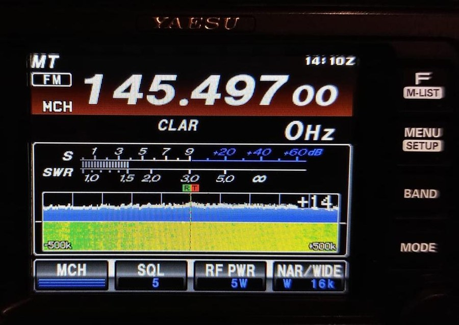
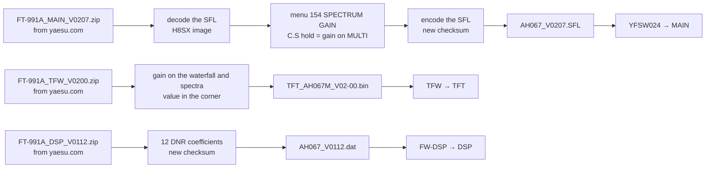

# FT-991A SPECTRUM GAIN and gentler DNR — firmware patches for the Yaesu FT-991A (SP9TKN)

> 🇵🇱 Polish version: [README.pl.md](README.pl.md)

> [!WARNING]
> Changing a radio's firmware can leave it unusable. You do it at your own risk. **FT-991A only** (not the FT-991,
> which has a different processor), and only from Yaesu's official **MAIN V02-07**, **TFT V02-00** and **DSP V01-12**.
> Nothing about transmission is changed.

**A patcher for the Yaesu FT-991A with two improvements:**

- **SPECTRUM GAIN** (MAIN + TFT): a new menu item *154 SCOPE SPECTRUM GAIN* (−20…+20) that lifts or lowers the
  waterfall and both spectrum views, and a quick way to change it on the air — hold C.S for about a second and turn
  MULTI, with the value shown in the corner of the spectrum.
- **Gentler DNR** (DSP, optional): the digital noise reduction gets the FTDX10's coefficients, so it no longer eats
  the signal as hard.

The script works on your own copies of Yaesu's firmware files; this repository contains no Yaesu code.

<p align="center">
  
</p>
<p align="center"><sub>The author's FT-991A with the patches: SPECTRUM GAIN +14 shown in the corner of the spectrum
right after turning MULTI.</sub></p>

## What it does

- **MAIN:** menu item *154 SCOPE SPECTRUM GAIN*, −20…+20; 0 is the factory picture. It is kept with the other menu
  settings.
- **C.S key:** a short press works as before (the menu shortcut). Hold it for about 1 s (two beeps) and MULTI changes
  SPECTRUM GAIN; the mode ends about 1 s after it is switched on or after the last turn. In an open menu the long
  press does nothing.
- **TFT:** the gain acts on the waterfall and on both spectrum views. While the C.S mode is on, the value is drawn in
  the top right corner of the spectrum.
- **DSP (optional): a gentler DNR.** Twelve DNR coefficients (levels 1–8, and 1–4 in the second table) get the
  values of the FTDX10 (IFDSP V01-20). They come from the *FT991A DSP V0112 DNR NEWGEN BACKPORT* package published on
  radio.xreflector.es, whose author is not named; the package lists them in its PATCH_DIFF.txt. Only these 12 numbers
  are used: the patcher writes them into your copy of Yaesu's DSP V01-12 and recalculates the checksum, and the result
  is byte for byte the file from that package. In the author's radio DNR is noticeably less aggressive.

## How to use

1. Download from yaesu.com `FT-991A_MAIN_V0207.zip` and `FT-991A_TFW_V0200.zip`, and for the DNR also
   `FT-991A_DSP_V0112.zip` (check that your radio shows MAIN V02-07, TFT V02-00 and DSP V01-12, or update it with these
   files first).
2. Run (Python 3.8 or newer, no extra packages):
   ```
   python ft991a_patch.py --main FT-991A_MAIN_V0207.zip --tft FT-991A_TFW_V0200.zip --dsp FT-991A_DSP_V0112.zip --out patched
   ```
   `--dsp` is optional, and it also works on its own (`--dsp … --out patched`). MAIN and TFT always go together.
   The script checks the SHA-256 of both inputs and that its results are byte-for-byte the files running in the
   author's radio. It writes `patched/AH067_V0207.SFL`, `patched/TFT_AH067M_V02-00.bin` (and `patched/AH067_V0112.dat`)
   and flashes nothing.
3. Save your menu settings and memories first. Then flash **MAIN first** with Yaesu's YFSW024 from the same zip, as in
   Yaesu's manual; for the patched file YFSW024 shows the checksums `036C21F9` and `056A21F9`. Then flash the TFT with
   Yaesu's TFW, and the DSP with Yaesu's FW-DSP from the DSP zip.
4. To go back, flash the original files the same way.

## How it works



- **MAIN** (Renesas H8SX): the SFL file is text S-records scrambled per line with a rotating 43-byte key, as
  documented by [PatchworkHam/FTDX10_Firmware_asm](https://github.com/PatchworkHam/FTDX10_Firmware_asm). The script
  decodes it, first checks that re-encoding gives the original file byte for byte, then adds the menu item and the C.S
  handling in free flash and recalculates the checksum in the header.
- **TFT** (Renesas SuperH SH-2A, a plain image at 0x0C000000): a hook in the spectrum sample handler applies the gain;
  a small routine with a 5×7 font draws the value.
- Every version was checked by running the real patched code in an emulator before it went into the radio.
  `tools/h8sx_dis.py` is the H8SX disassembler written for this work, and
  [docs/cs-button-notes.pl.md](docs/cs-button-notes.pl.md) (Polish) describes how the radio handles the C.S key.

## Files

| File | |
|---|---|
| `ft991a_patch.py` | the patcher: runs the final chain and checks the results |
| `tools/build_test.py` | SFL decoding and encoding, menu item 154, the TFT gain hook (step "test_03") |
| `tools/build_test08.py` | C.S: short press as before, long press = gain on MULTI |
| `tools/build_test09.py`, `tools/build_test10.py` | the value in the corner of the spectrum, shown only in the C.S mode |
| `tools/build_test11.py` | the C.S mode ends about 1 s after the last turn (the version in use) |
| `tools/dsp_dnr.py` | the 12 DNR coefficients for the DSP and the DSP checksum |

## License

[GPL-3.0](LICENSE) © 2026 SP9TKN for the scripts. The FT-991A firmware is Yaesu's and is not included. The DNR
coefficients are credited to the package named above.

**Tools:** developed with [Claude Code](https://claude.com/claude-code) (Anthropic) — AI assistant used for
coding, testing and documentation.
