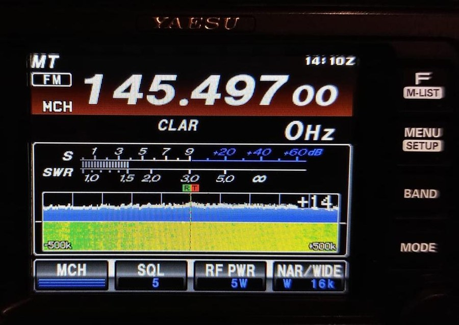
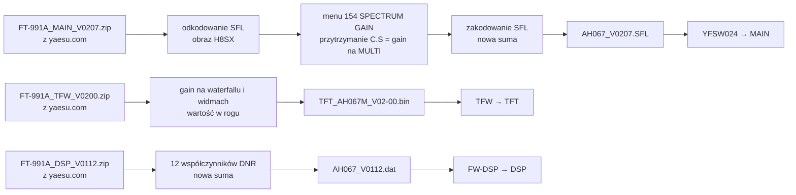

# FT-991A SPECTRUM GAIN — łatki firmware'u Yaesu FT-991A (SP9TKN)

> 🇬🇧 English version: [README.md](README.md)

> [!WARNING]
> Zmiana firmware'u radia może je unieruchomić. Robisz to na własne ryzyko. **Tylko FT-991A** (nie FT-991, który ma
> inny procesor) i tylko z oficjalnych plików Yaesu **MAIN V02-07**, **TFT V02-00** i **DSP V01-12**. Nic
> w nadawaniu nie jest zmieniane.

**Patcher, który dodaje do Yaesu FT-991A regulację SPECTRUM GAIN: nową pozycję menu *154 SCOPE SPECTRUM GAIN*
(−20…+20), która podnosi albo obniża waterfall i oba widoki widma, oraz szybką zmianę w trakcie pracy — przytrzymaj
C.S przez ok. sekundę i kręć MULTI, a wartość pojawi się w rogu widma.** Opcjonalnie łagodzi też DNR. Skrypt działa
na Twoich kopiach plików firmware'u Yaesu; w repozytorium nie ma kodu Yaesu.

<p align="center">
  
</p>
<p align="center"><sub>FT-991A autora z łatkami: SPECTRUM GAIN +14 w rogu widma tuż po obróceniu MULTI.</sub></p>

## Co robi

- **MAIN:** pozycja menu *154 SCOPE SPECTRUM GAIN*, −20…+20; 0 to obraz fabryczny. Zapisuje się razem z innymi
  ustawieniami menu.
- **Przycisk C.S:** krótkie naciśnięcie działa jak dotąd (skrót do menu). Przytrzymanie ok. 1 s (dwa piski) przełącza
  MULTI na SPECTRUM GAIN; tryb kończy się ok. 1 s po włączeniu albo po ostatnim obrocie. W otwartym menu długie
  naciśnięcie nic nie robi.
- **TFT:** wzmocnienie działa na waterfall i na oba widoki widma. Gdy tryb C.S jest włączony, wartość jest rysowana
  w prawym górnym rogu widma.
- **DSP (opcjonalnie): łagodniejszy DNR.** Dwanaście współczynników DNR (poziomy 1–8 oraz 1–4 w drugiej tabeli)
  dostaje wartości z FTDX10 (IFDSP V01-20). Pochodzą z paczki *FT991A DSP V0112 DNR NEWGEN BACKPORT* opublikowanej na
  radio.xreflector.es, której autor nie jest podany; paczka wypisuje je w PATCH_DIFF.txt. Użyte jest tylko tych 12
  liczb: patcher wpisuje je do Twojej kopii DSP V01-12 od Yaesu i przelicza sumę kontrolną, a wynik jest bajt w bajt
  plikiem z tamtej paczki. W radiu autora DNR jest wyraźnie mniej agresywny.

## Jak użyć

1. Pobierz z yaesu.com `FT-991A_MAIN_V0207.zip` i `FT-991A_TFW_V0200.zip`, a do DNR także `FT-991A_DSP_V0112.zip`
   (sprawdź, że radio ma MAIN V02-07, TFT V02-00 i DSP V01-12, albo najpierw zaktualizuj je tymi plikami).
2. Uruchom (Python 3.8 lub nowszy, bez dodatkowych pakietów):
   ```
   python ft991a_patch.py --main FT-991A_MAIN_V0207.zip --tft FT-991A_TFW_V0200.zip --dsp FT-991A_DSP_V0112.zip --out patched
   ```
   `--dsp` jest opcjonalne i działa też samo (`--dsp … --out patched`). MAIN i TFT zawsze idą razem.
   Skrypt sprawdza SHA-256 obu plików wejściowych i to, że wynik jest bajt w bajt taki jak pliki działające w radiu
   autora. Zapisuje `patched/AH067_V0207.SFL`, `patched/TFT_AH067M_V02-00.bin` (i `patched/AH067_V0112.dat`) i niczego
   nie wgrywa.
3. Najpierw zapisz ustawienia menu i pamięci. Potem wgraj **najpierw MAIN** programem YFSW024 z tej samej paczki,
   zgodnie z instrukcją Yaesu; dla zmienionego pliku YFSW024 pokazuje sumy `036C21F9` i `056A21F9`. Następnie wgraj
   TFT programem TFW od Yaesu, a DSP programem FW-DSP z paczki DSP.
4. Powrót: wgraj w ten sam sposób oryginalne pliki.

## Jak to działa



- **MAIN** (Renesas H8SX): plik SFL to tekstowe rekordy S, zaszyfrowane w każdej linii obracanym kluczem 43 bajtów,
  jak opisano w [PatchworkHam/FTDX10_Firmware_asm](https://github.com/PatchworkHam/FTDX10_Firmware_asm). Skrypt go
  odkodowuje, najpierw sprawdza, że ponowne zakodowanie daje oryginał bajt w bajt, potem dopisuje pozycję menu i obsługę
  C.S w wolnym flashu i przelicza sumę w nagłówku.
- **TFT** (Renesas SuperH SH-2A, jawny obraz od 0x0C000000): zaczep w obsłudze próbki widma nakłada wzmocnienie; mała
  procedura z czcionką 5×7 rysuje wartość.
- Każda wersja przed wgraniem do radia była sprawdzana uruchomieniem prawdziwego, zmienionego kodu w emulatorze.
  `tools/h8sx_dis.py` to dezasembler H8SX napisany do tej pracy, a [docs/cs-button-notes.pl.md](docs/cs-button-notes.pl.md)
  opisuje, jak radio obsługuje przycisk C.S.

## Pliki

| Plik | |
|---|---|
| `ft991a_patch.py` | patcher: uruchamia końcowy łańcuch i sprawdza wyniki |
| `tools/build_test.py` | odkodowanie i zakodowanie SFL, pozycja menu 154, zaczep wzmocnienia w TFT (krok „test_03”) |
| `tools/build_test08.py` | C.S: krótkie jak dotąd, długie = gain na MULTI |
| `tools/build_test09.py`, `tools/build_test10.py` | wartość w rogu widma, widoczna tylko w trybie C.S |
| `tools/build_test11.py` | tryb C.S kończy się ok. 1 s po ostatnim obrocie (wersja używana) |
| `tools/dsp_dnr.py` | 12 współczynników DNR dla DSP i suma kontrolna DSP |

## Licencja

[GPL-3.0](LICENSE) © 2026 SP9TKN dla skryptów. Firmware FT-991A należy do Yaesu i nie jest dołączony.
Współczynniki DNR pochodzą z paczki wymienionej wyżej.

**Narzędzia:** program powstał z pomocą [Claude Code](https://claude.com/claude-code) (Anthropic) — asystent AI
do pisania kodu, testów i dokumentacji.
